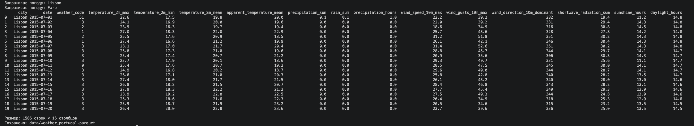

# Скрипты

## read_api.py — погода в Португалии через Open-Meteo API

**Источник:** [Open-Meteo Historical Weather API](https://open-meteo.com/en/docs/historical-weather-api) — бесплатный публичный API с историческими данными о погоде. Ключ не нужен; данные распространяются по лицензии CC BY 4.0.

**Что собирается:** ежедневная погода за период с 2015-07-01 по 2017-08-31 для двух городов:

- **Lisbon** — там находится городской отель (City Hotel) из датасета Hotel booking demand;
- **Faro** (Алгарве) — регион курортного отеля (Resort Hotel).

Период и города выбраны так, чтобы погоду можно было сопоставить с бронированиями: например, проверить, как дождь или жара связаны с отменами и спросом.

**Как работает:**

1. для каждого города отправляется один GET-запрос к API (всего 2 запроса);
2. ответ (JSON) превращается в таблицу pandas, добавляется столбец `city`;
3. типы приводятся: `date` → datetime, `city` → category, `weather_code` → Int16, длительность солнца и светового дня переводится из секунд в часы, дробные значения → float32;
4. результат сохраняется в `data/weather_portugal.parquet` (в репозиторий не коммитится).

**Датасет:** 1586 строк (2 города × 793 дня), 16 столбцов.

| Столбец | Описание |
|---|---|
| city | Город |
| date | Дата |
| weather_code | Код погоды WMO (0 — ясно, 61 — дождь и т.д.) |
| temperature_2m_max / min / mean | Температура воздуха, °C |
| apparent_temperature_mean | Ощущаемая температура, °C |
| precipitation_sum, rain_sum | Осадки и дождь, мм |
| precipitation_hours | Часов с осадками |
| wind_speed_10m_max, wind_gusts_10m_max | Скорость ветра и порывы, км/ч |
| wind_direction_10m_dominant | Преобладающее направление ветра, ° |
| shortwave_radiation_sum | Солнечная радиация, МДж/м² |
| sunshine_hours | Часов солнца |
| daylight_hours | Продолжительность светового дня, ч |

**Запуск** (из корня репозитория):

```bash
uv sync --locked
uv run python scripts/read_api.py
```

**Пример выдачи (первые 20 строк):**

